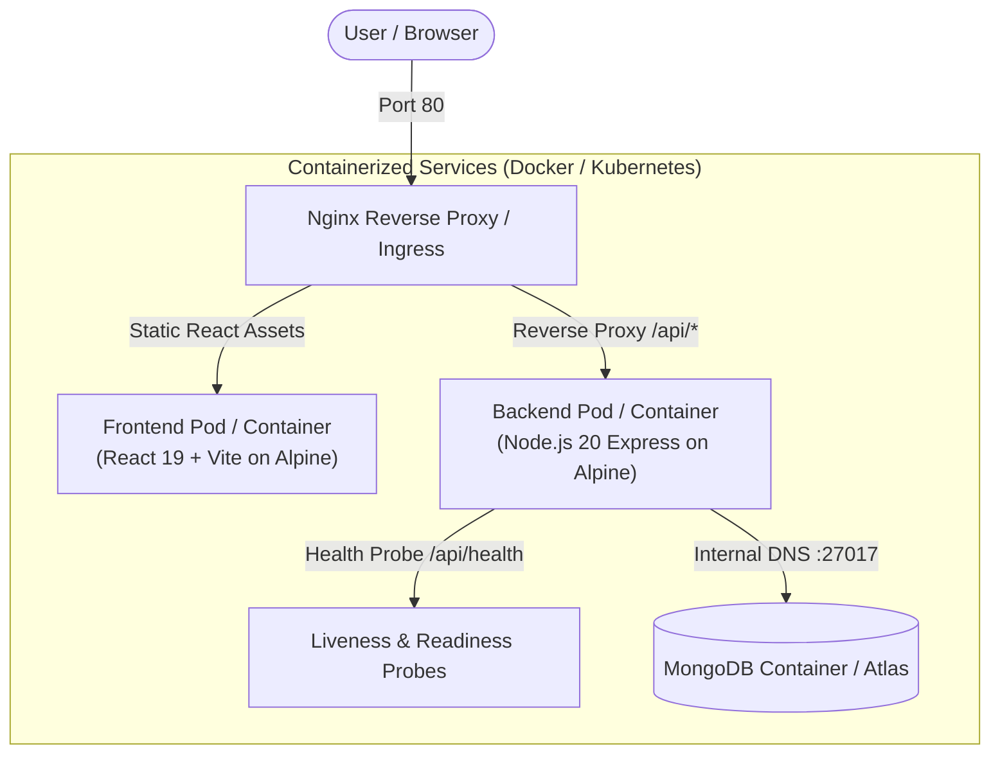

# SpendWise 🚀

SpendWise is a gamified, full-stack personal finance platform and predictive analytics system designed with enterprise-grade cloud architecture, containerized microservices, and automated CI/CD pipelines.

---

## 🏗️ Architecture & Cloud Infrastructure

SpendWise is fully containerized and production-ready for deployment on **Kubernetes (AKS / EKS / GKE)** and local container orchestration via **Docker Compose**.



### Key Cloud & DevOps Features:
- 🐳 **Multi-Stage Docker Builds:** Optimized Alpine Linux builds reducing final container footprint by over 65%, featuring non-root user execution (`USER node`) for Linux security compliance.
- ⚡ **Edge Reverse Proxy (Nginx):** Frontend container runs an Nginx reverse proxy routing `/api/` traffic directly to the backend service internally, eliminating CORS issues at the network level.
- 🔄 **Local Multi-Service Orchestration:** Full local environment orchestration with `docker-compose.yml` spinning up Frontend, Backend, and MongoDB with integrated health checks and named persistent volumes.
- ☸️ **Production Kubernetes (K8s) Manifests:** Complete infrastructure-as-code manifests under `k8s/` including Deployments, Services, ConfigMaps, Secrets, Ingress, and Horizontal Pod Autoscalers (HPA).
- 🤖 **Automated CI/CD:** GitHub Actions workflow (`.github/workflows/docker-ci.yml`) automating code quality checks, multi-platform Docker builds, and Buildx layer caching.
- 🩺 **Zero-Downtime Health Probes:** Built-in `/api/health` probe checking process uptime, memory, and database connectivity for Kubernetes rolling updates.

---

## 🌟 Application Features
- **Predictive Analytics Engine:** Forecasts future spending trajectories using a Blended Velocity model and user personas.
- **Financial Discipline Gamification:** Dynamic streak tracking system rewarding budget adherence.
- **Enterprise-Grade Authentication:** Multi-tier JWT architecture with secure HttpOnly cookie rotation and silent-refresh Axios interceptors.
- **Interactive Dashboards:** Responsive Recharts data visualizations with dark/light themes.
- **Export Pipelines:** Automated CSV and PDF financial report generation.

---

## 🛠️ Tech Stack
- **Frontend:** React 19, Vite, Tailwind CSS v4, Recharts, Headless UI
- **Backend:** Node.js 20, Express 5, Mongoose, JWT, Cookie-Parser, Multer
- **Database:** MongoDB Atlas / Containerized MongoDB 7.0
- **Cloud & DevOps:** Docker, Docker Compose, Nginx, Kubernetes (AKS/EKS), GitHub Actions CI/CD

---

## 🚀 Quickstart: Run with Docker Compose

To spin up the entire application (Frontend, Backend, and MongoDB) with a single command:

```bash
docker compose up --build
```

- **Frontend Application & Reverse Proxy:** `http://localhost` (Port 80)
- **Backend API Direct:** `http://localhost:5000`
- **Backend Health Check:** `http://localhost:5000/api/health`
- **MongoDB Database:** `localhost:27017`

To stop and remove containers:
```bash
docker compose down
```

---

## ☸️ Deploying to Kubernetes (AKS / Minikube)

Apply the manifests in the `k8s/` directory:

```bash
kubectl apply -f k8s/namespace.yaml
kubectl apply -f k8s/configmap-secrets.yaml
kubectl apply -f k8s/backend.yaml
kubectl apply -f k8s/frontend.yaml
kubectl apply -f k8s/ingress-hpa.yaml
```

Verify deployment status:
```bash
kubectl get pods -n spendwise
kubectl get hpa -n spendwise
```

---

## 💻 Local Development (Without Docker)

1. **Install dependencies:**
   ```bash
   cd backend && npm install
   cd ../frontend && npm install
   ```

2. **Run Backend:**
   ```bash
   cd backend
   npm run dev
   ```

3. **Run Frontend:**
   ```bash
   cd frontend
   npm run dev
   ```
